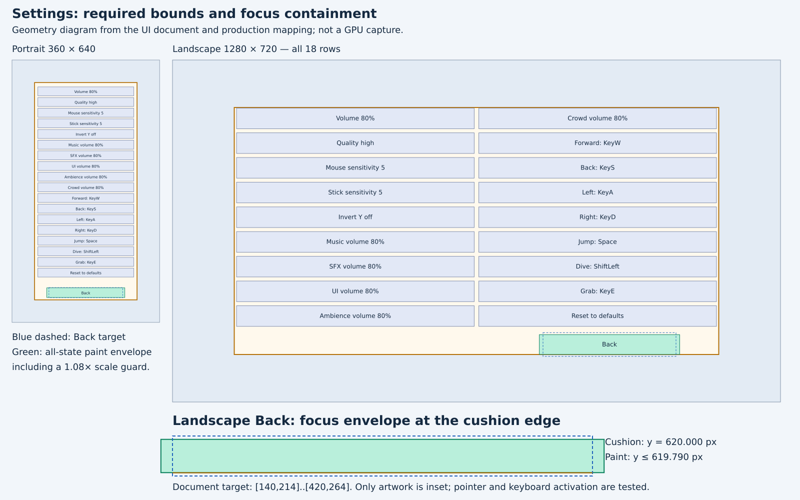

Settings layout review evidence
==============================



This diagram is **layout geometry evidence, not a game screenshot or GPU capture**.
It uses the actual Settings document, UAA's layout and asset bounds, and the
production `mapCapsule` function. The SVG and JSON contain the corresponding
vector diagram and measurements. No GPU job was run: this model card is forbidden
from running GPU jobs, and no programmatic card follows it.
The image judge was also attempted and refused with HTTP 403:
"A model never grades its own work: run the judge from a programmatic card."
No successful visual grade is claimed.

Back's landscape rectangle is `[140,214]..[420,264]`. Its portrait rectangle stays
`[-180,470]..[180,520]`. In landscape, the renderer insets only this button's artwork vertically
by 6% of its height, including its label, while retaining the full pointer target.
Portrait artwork, other Settings rows and other screens retain their existing mapping.

At 1280×720, Back's full target is `[780,574]..[1060,624]`. Its all-state paint
envelope, including the UI regression test's conservative 1.08× scale guard,
ends at **619.790 px**, inside the cushion's **620 px** bottom edge. The actual
focus bounce peaks at 1.05×. The diagram shows the 1.08× envelope for every row
and Back; it does not imply every button is focused simultaneously.

`apps/web/test/uiAssets.test.ts` checks all button states against the cushion at
360×640, 720×1280, 1280×720, and 1920×1080. It also checks every Settings row's
label and required bounds, the unchanged Back bounds, and pointer activation at
the bottom edge of the full target followed by keyboard activation.

Regenerate the evidence from the repository root:

```sh
node --experimental-strip-types tools/settingsLayoutProof.ts
```

Verification on the final code: web 236/236 (including both Settings screen-map
tests), game 661/661 across two sequential shards, sim 445/445,
`npm run typecheck`, and the full `npm run build` all passed.
